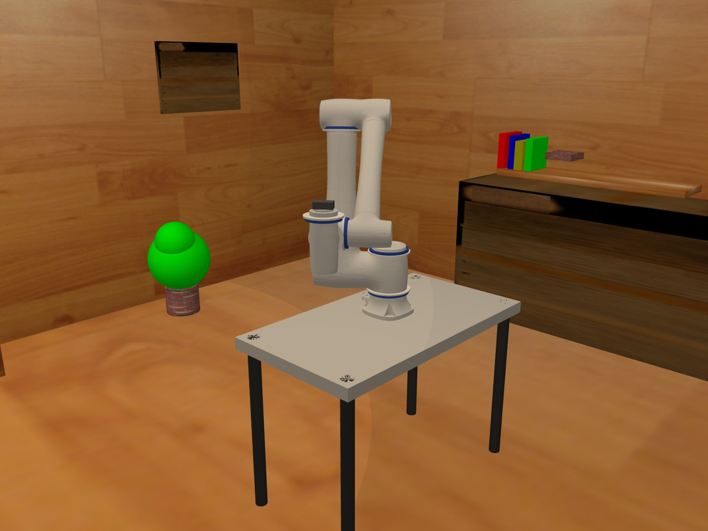

<div align="center">

# IRIS CR10A

**Interface Robótica de Inspeção Sensorial** para o robô colaborativo Dobot CR10A.


</div>

---

## A plataforma

### Controle do robô

- Conexão com o controlador do CR10A pela rede (TCP/IP), com conferência do estado do robô.
- Movimento de cada junta (aba **Controle Juntas**) e ajuste de velocidade (sempre
  visível na barra do robô, abaixo do cabeçalho).
- **Home**: no Controle Juntas, um cartão com a home e o botão **Ir para a home**. Para mudar,
  clique em **Alterar home** (os campos ficam escondidos no resto do tempo, para nenhum clique
  sem querer trocar a home). O botão **Ir para Home** da barra do robô também leva até ela.
- **Parar movimento** (parada normal, o robô continua conectado) e **botão de emergência**.
- **Painel de atividade** durante os ensaios: barra de progresso, relógio, etapa atual e o
  botão Parar.
- **Faixa de modo**, logo abaixo do cabeçalho: diz se os comandos vão para o **robô real** ou
  só para o **gêmeo virtual** (em âmbar, na simulação).
- **Rodapé de estado**: conexão, velocidade, segurança e posição das 6 juntas.
- **Registro** de tudo o que foi feito, com filtro de avisos e erros (aba **Registro**).

### Gêmeo virtual

Modelo do CR10A no **Gazebo**, em um laboratório com mesa, paredes e armários.

<p align="center">
  
</p>
<p align="center"><em>Gêmeo virtual no Gazebo, na posição home, com o sensor inercial S02 no flange.</em></p>

- **Modo real:** o gêmeo segue o robô em tempo real, lendo a posição pela porta de
  *feedback* do controlador (somente leitura — não comanda nada).
- **Modo simulação:** os comandos da interface movem **só o gêmeo**; o robô real não é
  tocado, e a interface mostra uma faixa laranja de aviso. A lógica é a mesma do modo real,
  então qualquer módulo pode ser testado na simulação antes de rodar no equipamento.
- **Três versões do modelo:** **com a célula de carga FA7155 e a ponteira** (o padrão do
  comando `iris`, a ferramenta montada no robô); **com o sensor inercial S02**
  preso no flange (opção `com-sensor`); ou sem nada na ponta (opção `sem-nada`).

### Segurança

1. **Proteções do controlador**, aplicadas toda vez que o robô é conectado: detecção de
   colisão (nível 1–5), carga na extremidade, recuo e parada após colisão. Se a detecção de
   colisão não for aceita pelo robô, a conexão é recusada.
2. **Verificação geométrica antes de cada movimento**, de qualquer módulo: o caminho
   inteiro é percorrido no modelo do robô, em passos de no máximo 10 mm, e o movimento é
   **recusado antes de sair do lugar** se alguma parte do braço for chegar perto demais da
   mesa, do chão, das paredes, dos armários ou do próprio braço.
3. **Limites de operação:** velocidade máxima de 50%, detecção de robô parado fora do
   destino e tempo máximo por movimento. A velocidade escolhida na barra do robô é
   **mandada de novo antes de cada movimento** (`SpeedFactor`), e o movimento sai com a
   aceleração limitada pela mesma porcentagem (`a=`), porque a velocidade global do robô
   não reduz a aceleração. Se o robô não aceitar a velocidade, o movimento é recusado.
4. **Ferramenta certa no modelo:** a ferramenta escolhida ao abrir (a célula de carga, que é
   o padrão; `com-sensor`; ou `sem-nada`) define a ferramenta da verificação de colisão e o
   peso enviado ao robô (perfis da seção `ferramentas`). **Abra sempre com a ferramenta que
   está parafusada no robô real.** Um perfil que não existe bloqueia todos os movimentos.
5. **Comunicação só local:** a plataforma abre o ROS 2 com `ROS_LOCALHOST_ONLY=1`, então
   outros computadores da rede não enxergam nem comandam os seus nós (por exemplo,
   `/connect` ou `/move_joint`). A conexão com o robô não muda: ela é TCP, não ROS.
   Para usar comandos `ros2 ...` em outro terminal, defina o mesmo valor nele
   (`export ROS_LOCALHOST_ONLY=1`), senão ele não enxerga a interface aberta.

Os parâmetros ficam em [`src/dobot_control/config/seguranca.yaml`](src/dobot_control/config/seguranca.yaml).

> [!IMPORTANT]
> As posições da mesa, das paredes e dos armários em `seguranca.yaml` ainda são as do
> laboratório do **gêmeo virtual**. Confira-as no laboratório real antes de usar.


## Como usar

Com o atalho `iris` instalado:

| Comando | O que faz |
|---|---|
| `iris` | Abre a interface com o **robô real** e o gêmeo seguindo em tempo real, com a **célula de carga FA7155** na ponta |
| `iris gemeo` | Abre em **simulação** (só o gêmeo virtual se move), com a célula de carga na ponta |
| `iris sem-gemeo` | Robô real, sem abrir o gêmeo |
| `iris sem-nada` | **Sem ferramenta** na ponta (vale com `gemeo` também: `iris gemeo sem-nada`) |
| `iris com-sensor` | Com o **sensor inercial S02** na ponta, em vez da célula (também com `gemeo`) |
| `iris code` | Abre o código no VS Code |
| `iris mudancas` | Mostra o que mudou desde a última versão salva |
| `iris salvar "descrição"` | Salva as mudanças e envia para este repositório |
| `iris ajuda` | Lista os comandos |

Para fechar a interface: **Ctrl+C** no terminal.

O comando `iris` é criado pelo `instalar.sh` (ver [Instalação](#instalação)). Sem ele,
o equivalente, na pasta do projeto, é:

```bash
./abrir_interface.sh          # robô real
./abrir_interface.sh gemeo    # simulação
```

---

## Instalação

**Requisitos:** Ubuntu 22.04, ROS 2 Humble e Gazebo Classic 11. Funciona em qualquer
computador e em qualquer pasta.

```bash
sudo apt install ros-humble-desktop ros-humble-gazebo-ros-pkgs ros-humble-gazebo-ros2-control \
                 ros-humble-ros2-controllers ros-humble-xacro python3-colcon-common-extensions \
                 python3-pyqt5 python3-numpy python3-scipy python3-yaml python3-matplotlib python3-serial

git clone https://github.com/mariaclarakfouri/IRIS-CR10A.git ~/iris
cd ~/iris
./instalar.sh
```

O `instalar.sh` cria o comando **`iris`** (em `~/.local/bin`, apontando para o arquivo
`iris` do repositório, então as atualizações chegam pelo `git pull`) e confere o que o
computador precisa: ROS 2 Humble, Gazebo, pacotes Python, grupo `dialout` (para a célula de
carga e as placas táteis pela USB) e o seu nome no git. Para o que faltar, ele mostra o comando
certo; não usa `sudo` nem instala nada sozinho. Depois, num terminal novo:

```bash
iris gemeo     # abre no gêmeo virtual (compila só quando algo mudou)
iris ajuda     # todas as opções
```

Sem o comando, `./abrir_interface.sh gemeo` (na pasta do projeto) faz o mesmo.

O robô deve estar na mesma rede do computador, no IP `192.168.5.2` (padrão), com o
controlador em modo **remoto (TCP/IP)**.

---

## Estrutura

```
src/
├── dobot_control/      servidor que fala com o robô (comandos, segurança, parada)
│                       e estado das juntas (nó estado_juntas)
│   └── config/seguranca.yaml
├── dobot_gui/          interface gráfica (PyQt5)
│   └── dobot_gui/
│       ├── janela.py       base comum (conexão, velocidade, home, parar, emergência)
│       ├── modulos/        um arquivo por módulo (uma aba da interface)
│       ├── tema.py         cores, estilo e ícones
│       └── widgets.py      peças visuais reutilizáveis
├── dobot_interfaces/   mensagens ROS 2 (ação de movimento e serviços)
└── dobot_twin/         gêmeo virtual: modelo do CR10A, laboratório e espelho
docs/
└── imagens/            imagens da documentação
iris                    o comando iris (instalado pelo instalar.sh)
instalar.sh             cria o comando iris e confere o computador
abrir_interface.sh      compila (só se algo mudou) e abre tudo
```

### Adicionando um módulo

1. Criar um arquivo em `src/dobot_gui/dobot_gui/modulos/`, com uma classe que herda de
   `Modulo` (veja [`modulos/base.py`](src/dobot_gui/dobot_gui/modulos/base.py)), e
   acrescentá-la à lista `MODULOS` em `modulos/__init__.py`. Ela aparece sozinha na barra
   lateral.
2. Mover o robô pelos métodos da base comum (`mover_e_esperar`, `ir_para_home_e_conferir`,
   `esperar`), que já passam pela segurança, respeitam o botão Parar e funcionam no gêmeo
   virtual.
3. Documentar o módulo no README.
4. Testar com `iris gemeo` antes de usar no robô real.

---

## Manuais oficiais

Documentos do fabricante do robô usados no projeto.

**Robô Dobot CR10A** (Shenzhen Yuejiang Technology Co., Ltd.). Os arquivos **não estão neste
repositório**: os manuais da Dobot proíbem a reprodução sem autorização por escrito. Baixe-os
na [Central de Downloads da Dobot](https://www.dobot-robots.com/service/download-center):

| Manual | Versão | Para que serve aqui |
|---|---|---|
| *Dobot CR A Series User Guide* | V1.8 (11/05/2024) | O robô: especificações (o CR10A pesa 40 kg, pág. 85), instalação (a base deve aguentar 10× o torque máximo da J1 e 5× o peso do braço, pág. 72), segurança e manutenção |
| *Dobot TCP/IP Remote Control Interface Guide* | V4.5.1 (15/08/2024); a mais nova é a [V4.6.6 (27/05/2026)](https://a.storyblok.com/f/298593/x/ce7fbaa06a/dobot-tcp_ip-remote-control-interface-guide-v4-6-6_20260527_en.pdf) | Comandos pela rede (porta 29999) e o pacote de *feedback* em tempo real (porta 30004): ângulo, velocidade, corrente, temperatura e torque das juntas (cap. 3: págs. 101 a 104 na V4.5.1, 156 e 158 na V4.6.6, com os mesmos campos nos mesmos bytes). |
| *Dobot CRStudio User Guide (CR & Nova)* | V4.13.0 / 2.14.0 | O programa da Dobot e o *Appendix A – Modbus Register Definition* (pág. 96), com os mesmos dados de *feedback* |
| *Dobot Force Sensor User Guide* | V1.0 (29/07/2022) | Referência geral dos sensores de força da Dobot |


---

## Créditos

- **Gêmeo virtual** — modelo do CR10A (URDF e malhas), laboratório do Gazebo, conversão de
  ângulos e leitura do *feedback* do robô: baseados no projeto
  [cr10twin](https://github.com/Martins-Lucaas/cr10twin), de **Lucas Martins**
  ([@Martins-Lucaas](https://github.com/Martins-Lucaas)), licença Apache-2.0. O modelo do
  robô vem dos arquivos oficiais da Dobot
  ([DOBOT_6Axis_ROS2_V4](https://github.com/Dobot-Arm/DOBOT_6Axis_ROS2_V4)).
  Detalhes em [`src/dobot_twin/NOTICE.txt`](src/dobot_twin/NOTICE.txt).
- **Ferramenta da ponta** — o modelo da célula de carga FA7155 com a ponteira no gêmeo
  virtual (peças e massas) é do mesmo projeto
  [cr10twin](https://github.com/Martins-Lucaas/cr10twin), de **Lucas Martins**.

## Agradecimentos

- **Lucas Martins** ([@Martins-Lucaas](https://github.com/Martins-Lucaas)) — pelo
  desenvolvimento do gêmeo virtual.

---

**Autora:** Maria Clara Almeida Kfouri Trazzi
