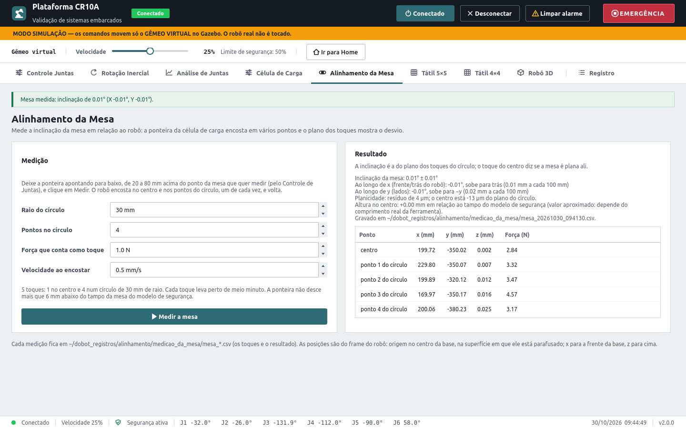

# Módulo: Alinhamento da Mesa

[← Voltar para a plataforma CR10A](../../README.md)

> [!NOTE]
> **Em andamento.** A medição funciona no gêmeo virtual; ainda falta validá-la no robô real
> com a célula de carga.

Mede **o quanto a mesa está inclinada em relação ao robô**. A ponteira da célula de carga
encosta na mesa num ponto central e em vários pontos num círculo em volta, e a célula percebe
cada toque. O plano que passa pelos toques mostra a inclinação em x e em y e se a mesa é plana
ali.

É a etapa de **medição** da "calibração do ângulo de ataque" do projeto cr10twin. A conta do
plano é a dele, sem mudanças. A etapa seguinte, girar o punho para a ponteira ficar
perpendicular à mesa, ainda **não** está aqui: a aba mede e mostra, e você decide o que fazer,
por exemplo calçar a mesa.

---

  

<em>Gêmeo virtual com a célula: resultado de uma medição (centro + 4 pontos, raio
de 30 mm), começando com a ponteira para baixo, 50 mm acima do tampo.</em>

## Como usar

1. Abra com a célula, que é o padrão: `iris`, ou `iris gemeo` para testar. Sem
   a célula (`sem-nada` ou `com-sensor`), a aba avisa e o botão fica travado.
2. Pelo **Controle de Juntas**, deixe a ponteira **apontando para baixo**, até 20° de desvio,
   de **20 a 80 mm acima** do ponto da mesa que quer medir. O círculo de toques tem de caber
   inteiro na mesa, sem nada no caminho.
3. Na aba **Alinhamento da Mesa**, escolha as opções e clique em **Medir a mesa**.

| Opção | O que faz | Padrão |
|---|---|---|
| Raio do círculo | Distância dos toques ao centro. Maior = inclinação mais precisa | 30 mm |
| Pontos no círculo | Quantos toques em volta do centro (mín. 3) | 4 |
| Força que conta como toque | Quanto a força tem de mudar para o toque ser reconhecido | 1,0 N |
| Velocidade ao encostar | Velocidade dos últimos milímetros. Mais devagar = toque mais leve | 0,5 mm/s |

## O que o robô faz

Para cada ponto, primeiro o centro e depois os do círculo:

1. **Desce rápido** (4 mm/s) até perto da mesa: no 1º toque, até 8 mm acima do tampo do
   modelo de segurança; nos outros, até uma margem acima do toque mais alto já medido. Se
   encostar nessa parte, para, recua 3 mm e segue devagar.
2. **Desce devagar** até a força mudar o valor escolhido. O servidor confere a força **antes
   de cada ponto do movimento**, a cada 50 ms, e para na hora.
3. **Sobe** de volta à altura em que a ponteira estava e vai, nessa altura, ao próximo ponto.

No fim, a ponteira volta para cima do centro. Com o padrão, são 5 toques, cerca de 3 minutos.
A ponteira se move **em linha reta, sem mudar a orientação**: o servidor calcula as juntas
para cada milímetro do caminho com a cinemática do mesmo modelo do robô que a segurança usa.

## O resultado

| Item | O que é |
|---|---|
| **Inclinação da mesa** | O ângulo entre a mesa e o plano em que o robô está parafusado, com a incerteza da própria medição |
| **Ao longo de x / de y** | A inclinação em cada direção do robô (x para a frente da base), para que lado sobe e quantos mm a cada 100 mm |
| **Planicidade** | O resíduo do ajuste do plano e quanto o toque do centro fica fora dele. Mais de 0,5 mm gera um aviso: a mesa tem curvatura, sujeira ou algo embaixo |
| **Altura no centro** | Onde a mesa está em relação ao tampo do modelo de segurança. É aproximada, porque depende do comprimento real da ferramenta |

Se a ponteira estiver um pouco torta, todos os toques encostam na mesma quina. Isso desloca as
alturas igualmente e **não muda a inclinação medida**.

Cada medição fica em `~/dobot_registros/alinhamento/medicao_da_mesa/mesa_AAAAMMDD_HHMMSS.csv`, a mesma
pasta para o gêmeo virtual e para o robô real (a primeira linha diz onde a medição foi feita:
`feita no gêmeo virtual` ou `feita no robô real`): o resultado nas linhas com `#` e uma linha
por toque, com a posição da face da ponteira (x, y, z em mm, no frame do robô),
a força na parada e as 6 juntas.

## Segurança

- **Só a ponteira pode chegar à mesa**, e só neste movimento. A verificação de segurança passa a
  olhar a ferramenta **sem a ponteira** (os 18 mm finais) contra a mesa, com margem de 5 mm.
  O resto do braço e os outros obstáculos continuam com a margem normal de 20 mm.
- A ponteira **nunca desce mais que 6 mm abaixo do tampo** da mesa do modelo. Se a mesa real
  estiver mais baixa, o robô para sem encostar e a aba explica.
- Perto da mesa, a ponteira **só desce parando ao sentir o toque**. Subir na vertical, saindo
  da mesa, é sempre permitido.
- Se a célula **parar de mandar dados** durante a descida, o movimento para. Se a força passar
  de **40 N**, também.
- **Parar movimento** e **EMERGÊNCIA** funcionam como em todos os movimentos.

Os valores estão em [`seguranca.yaml`](../../src/dobot_control/config/seguranca.yaml):
`margem_contato_mm`, `profundidade_contato_mm` e `ponteira_mm`, este no perfil `celula_fa7155`.

> [!IMPORTANT]
> Testado no **gêmeo virtual**: a mesa do gêmeo é plana, e a medição deu 0,02° ± 0,01°, com os
> toques a menos de 0,03 mm do tampo do modelo. Na primeira vez no robô real, comece com a
> ponteira perto da mesa (uns 30 mm), fique perto da EMERGÊNCIA e confira antes, na aba Célula
> de Carga, que apertar a ponteira com o dedo muda a força.

---

## Onde está no código

| O quê | Onde |
|---|---|
| Página e sequência dos toques | [`src/dobot_gui/dobot_gui/modulos/alinhamento_mesa.py`](../../src/dobot_gui/dobot_gui/modulos/alinhamento_mesa.py) |
| Conta do plano (do cr10twin, sem mudanças) | [`src/dobot_gui/dobot_gui/plane_probe.py`](../../src/dobot_gui/dobot_gui/plane_probe.py), créditos em [`NOTICE.txt`](../../src/dobot_gui/NOTICE.txt) |
| Ponteira em linha reta, parando ao encostar | [`dobot_action_server.py`](../../src/dobot_control/dobot_control/dobot_action_server.py) (`mover_ponta_callback`), action [`MoverPonta.action`](../../src/dobot_interfaces/action/MoverPonta.action) |
| Cinemática da ponteira | [`src/dobot_control/dobot_control/cinematica.py`](../../src/dobot_control/dobot_control/cinematica.py) |
| Exceção da segurança para encostar | [`seguranca.py`](../../src/dobot_control/dobot_control/seguranca.py) (`contato_mesa`) |
