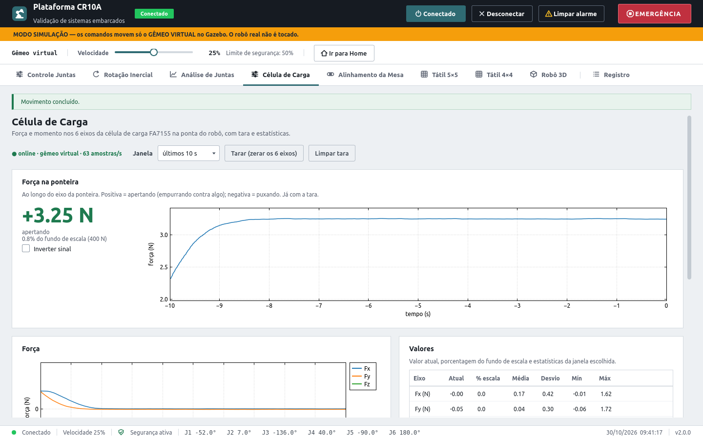

# Módulo: Célula de Carga

[← Voltar para a plataforma CR10A](../../README.md)

Leitura da **célula de carga FA7155 de 6 eixos** presa na ponta do robô, com a ponteira:
força (Fx, Fy, Fz) e momento (Mx, My, Mz) ao vivo, tara e estatísticas. Na
interface, fica na aba **Célula de Carga**.

<p align="center">
  
</p>
<p align="center"><em>Gêmeo virtual com a célula, no home: a ponteira aponta para cima, então o
peso dela (3,25 N) empurra a célula e aparece como força positiva ("apertando"), em verde.</em></p>

---

## Como abrir

A célula é a **ferramenta padrão** do comando `iris`, então basta abrir a plataforma:

```bash
iris          # robô real com a célula parafusada
iris gemeo    # gêmeo virtual com a célula
```

Abrir com a célula muda três coisas de uma vez, para nunca ficarem diferentes entre si:

1. **Segurança e peso no robô:** a verificação de colisão passa a usar a ferramenta com a
   célula (uma caixa de 88 × 88 × 67,7 mm, que cobre o conector em qualquer giro) e o robô
   recebe a carga de 0,3837 kg. É o perfil `celula_fa7155` do
   [`seguranca.yaml`](../../src/dobot_control/config/seguranca.yaml).
2. **Gêmeo virtual:** o modelo do robô ganha a célula com a ponteira e um sensor de força
   simulado (ver abaixo).
3. **Leitura:** no robô real, quem abre o conversor USB-RS485 é o `ft_receiver` do cr10twin
   (o mesmo que alimenta a aba [Coletas](coletas.md), em modo polled e 1 Mbaud, como lá); o nó
   `celula_carga` só ouve o que ele publica e segue igual para esta aba. No gêmeo, o nó
   `celula_carga` lê o sensor simulado.

> [!IMPORTANT]
> Abra **com a ferramenta que está parafusada no robô real**: a célula é o padrão; para o
> sensor S02 use `iris com-sensor`, e sem nada na ponta, `iris sem-nada`. Com a
> ferramenta errada, a segurança protege a peça errada (a célula é bem maior que o S02 e
> poderia bater sem ser detectada).

## A ferramenta

Do flange do robô para fora (medidas do CAD, mesma pilha do projeto cr10twin):

| Peça | Tamanho | Massa |
|---|---|---|
| Flange fixo de alumínio | ⌀75 × 6 mm | 51,8 g |
| Célula FA7155 (6 eixos) | ⌀75 × 36,5 mm, conector até 44 mm do centro | 300 g (catálogo) |
| Acoplador hot-swap (impresso) | ⌀66 × 10 mm + haste ⌀15 | 27,5 g |
| Ponteira F (impressa) | face de contato 15 × 17 mm | 4,3 g |
| **Total** | face de contato a **67,7 mm** do flange | **383,7 g**, centro de massa a 19,5 mm |

## A aba

| Parte | O que mostra |
|---|---|
| **● online / offline** | No começo da barra: **● online** (verde, com a origem e as amostras por segundo) quando os dados chegam; **● conectada, sem dados** (âmbar) quando o conversor abriu mas nada chega; **● offline** (vermelho) quando a célula não está conectada ou a plataforma foi aberta sem ela (`sem-nada` ou `com-sensor`). Passando o mouse, o motivo |
| **Força na ponteira** | A força ao longo da ponteira, em número grande e num gráfico: **positiva = apertando** (empurrando contra algo, número **verde**), **negativa = puxando** (número **vermelho**), e "solta" abaixo de 0,2 N; embaixo do número aparece o **peso equivalente em gramas** (força ÷ 9,81 m/s²: um peso de 500 g dá 4,90 N); abaixo de **0,12 N** o número mostra **0,00 N**, porque essa é a **resolução** da FA7155 (0,03% do fundo de escala, manual pág. 7): um "−0,01 N" depois de soltar é ruído, não força (número na cor normal). É −Fz da célula (mesma convenção do cr10twin), já com a tara |
| **Força** e **Momento** | Os 3 eixos de cada um ao longo do tempo (o **Fz** aparece como **"Fz (apertar +)"**: na mesma convenção da Força na ponteira, apertar a célula sobe e puxar desce, e o "Inverter sinal" também vale para ele) (janela de 10, 30 ou 60 s), sempre em tempo real enquanto a célula estiver online; offline, os gráficos se limpam e voltam sozinhos quando ela mandar dados (desenhados direto com o Qt, ~60 vezes por segundo, como no Tátil 5×5; passando o mouse, aparecem os valores daquele instante) |
| **Valores** | Valor atual, **% do fundo de escala** (400 N e 20 N·m) e média, desvio, mínimo e máximo da janela, para cada eixo e para \|F\| e \|M\| |
| **Estado da célula** | De onde vêm os dados, quantas amostras por segundo chegam, erros do link (CRC, ressincronizações) e a tara |
| Aviso | Âmbar acima do fundo de escala; **vermelho** acima da sobrecarga segura de catálogo (300%) |

**Tarar** zera os 6 eixos com a média do último meio segundo. Faça com a ponteira livre, sem
encostar em nada. A tara é do programa: some ao fechar, e **Limpar tara** volta aos valores
como saem da célula. Lembre que o **peso da ponteira muda de eixo quando o punho gira**: uma
tara feita numa posição deixa de valer se a orientação mudar.

## Ligando a célula real

A FA7155 conversa pela RS485 de um de dois jeitos, e o exemplar do laboratório usa o primeiro:

- **polled** (o padrão): o computador **pergunta** (Modbus, função 0x03: "me dá os 6 eixos") e
  a célula **responde**. É o modo que o exemplar responde e o padrão do cr10twin. Sem a
  pergunta, ela fica calada.
- **stream**: a célula manda os quadros sozinha assim que é energizada, e o computador só
  escuta (o "Active Transmission Mode" do manual).

O modo é o parâmetro `ft_mode` do `ft_receiver` (`polled` ou `stream`; com `fonte:=serial`, o `modo_leitura` do nó `celula_carga`). O programa só
**lê**: os comandos que mudariam a configuração da célula (zerar por dentro, taxa, endereço,
velocidade) continuam bloqueados.

Ligação, pelo manual e pelo cr10twin:

| Fio da FA7155 | Vai para |
|---|---|
| vermelho `VCC` | **+24 V de uma fonte externa** (12 a 48 V) |
| preto `GND` | negativo da fonte **e** `GND` do conversor (referência comum) |
| amarelo `485_A` | `A` do conversor USB-RS485 |
| verde `485_B` | `B` do conversor |

O `+5V` do conversor **não** alimenta a célula. Sem o terra comum, a porta abre mas nenhum
quadro chega: a aba avisa isso no **Estado da célula**.

O conversor é achado sozinho pela USB (chips CH340, CP2102, FT232 e PL2303), e a
**velocidade também**: a leitura tenta **1 Mbaud** (a do exemplar da bancada do cr10twin) e,
se em 2,5 s não chegar nenhum quadro válido, **115200 baud**, que é a velocidade de fábrica
da FA7155 (manual, §4.3: *"The default baud rate for a six-axis force sensor upon power-on is
115200"*). Ela vai alternando até achar a da célula e fica nela. Para fixar uma velocidade,
use o parâmetro `baud` do nó `celula_carga` (0 = automático). Se o cabo sair, o nó tenta de
novo a cada 2 s.

**Se a aba disser "● conectada, sem dados"**, passe o mouse sobre o aviso (ou veja o **Estado
da célula**), que diz qual é o caso:

| A aba diz | O que é | O que fazer |
|---|---|---|
| *nenhum byte chega do conversor* (stream) ou *a célula não responde às perguntas* (polled) | A célula **não está falando** | Confira a **fonte de 24 V** (ligada e acesa: o USB não alimenta a célula), os fios A/B presos nos bornes e o GND ligado também no conversor. Se a célula funciona no cr10twin com a mesma ligação, confira o modo (`modo_leitura`) |
| *chegam N bytes/s, mas nenhuma medida válida* | A célula fala, mas o programa não entende | Espere alguns segundos (ele tenta as duas velocidades); se continuar, confira se os fios **A e B não estão trocados** |

> [!NOTE]
> Comandos de **escrita** no sensor (zerar a célula por dentro, mudar a taxa, o endereço ou o
> baud) ficaram de fora de propósito: o mapa desses registradores ainda não foi confirmado no
> cr10twin, e um endereço errado pode deixar o sensor inacessível (ele não tem reset de
> fábrica). A tara do programa substitui o zero no dia a dia.

### Conferindo o sinal na bancada

Com a célula ligada e a ponteira livre, aperte **Tarar** e empurre a ponta da ponteira com o
dedo, na direção do robô: a **Força na ponteira** tem de ficar **positiva** ("apertando"). Se
ficar negativa, marque **Inverter sinal** (a escolha fica salva). No gêmeo o sinal já foi
conferido: com a ponteira para baixo, o peso dela puxa e o Fz simulado dá +3,25 N.

## No gêmeo virtual

O gêmeo com a célula tem um **sensor de força simulado** na junta entre o flange e a célula
(plugin do Gazebo, ~60 amostras por segundo, ruído de ±0,02 N). Parado, ele mede o peso do que
fica abaixo dela: célula + acoplador + ponteira = 0,3318 kg × 9,81 = **3,25 N**, e esse peso
muda de eixo quando o punho gira. Logo depois de um movimento o valor oscila um pouco: espere
o braço assentar antes de tarar.

---

## Onde está no código

| O quê | Onde |
|---|---|
| Página | [`src/dobot_gui/dobot_gui/modulos/celula_carga.py`](../../src/dobot_gui/dobot_gui/modulos/celula_carga.py) |
| Gráficos ao vivo (Qt) | [`src/dobot_gui/dobot_gui/grafico_ao_vivo.py`](../../src/dobot_gui/dobot_gui/grafico_ao_vivo.py) |
| Leitura da célula (nó `celula_carga`) | [`src/dobot_celula/dobot_celula/celula_carga_node.py`](../../src/dobot_celula/dobot_celula/celula_carga_node.py) |
| Protocolo, modo polled (perguntas Modbus), reconexão e filtro (do cr10twin) | [`src/dobot_celula/dobot_celula/`](../../src/dobot_celula/dobot_celula/) — créditos em [`NOTICE.txt`](../../src/dobot_celula/NOTICE.txt) |
| Gêmeo com a célula | [`src/dobot_twin/urdf/cr10_robot_com_celula.xacro`](../../src/dobot_twin/urdf/cr10_robot_com_celula.xacro) |
| Perfil de segurança | [`src/dobot_control/config/seguranca.yaml`](../../src/dobot_control/config/seguranca.yaml), seção `ferramentas` |
