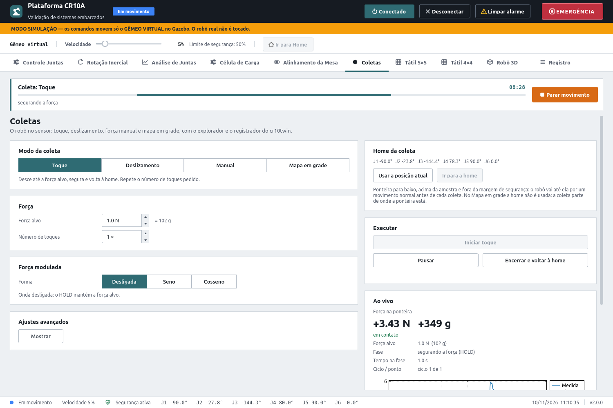

# Módulo: Coletas

[← Voltar para a plataforma CR10A](../../README.md)

> [!NOTE]
> **Em andamento.** A coleta completa funciona no gêmeo virtual, inclusive pela aba. Ainda
> falta o primeiro teste no robô real (ver [Primeiro teste no robô real](#primeiro-teste-no-robô-real)).

O robô no sensor: a ponteira da célula de carga desce até uma **força alvo**, segura e
mede. É a aba de palpação do projeto [cr10twin](https://github.com/Martins-Lucaas/cr10twin)
(Lucas Martins), com os mesmos modos, parâmetros, limites e validações. O código que move o
robô e grava os dados é o de lá, **sem mudanças**: o explorador (`tactile_explorer`), o
registrador e o leitor da célula (`ft_receiver`), no pacote `dobot_coletas`.

  

<em>Gêmeo virtual: toque de 1 N segurando a força (HOLD). No gêmeo a mesa é
rígida demais e a força oscila; numa amostra de verdade ela estabiliza.</em>

## Modos

| Modo | O que faz |
|---|---|
| **Toque** | Desce até a força alvo, segura e volta à home. Repete o número de toques pedido. Pode usar a **força modulada** (onda seno ou cosseno). |
| **Deslizamento** | Desce, segura, desliza de lado com a altura travada (a força varia com a textura) e volta. |
| **Manual** | Desce e segura até você encerrar. A força alvo pode ser mudada durante a coleta. Com a **escada de força**, sobe e desce por patamares sozinho (histerese). |
| **Mapa em grade** | Parte de onde a ponteira está (sem home). O primeiro contato vira a origem e cada ponto da grade é tocado com a mesma força (e com a escada, se ligada). |

No cartão **Força**: a força alvo, o número de toques (ou repetições) e a **duração do HOLD**:
quanto tempo o robô fica parado na amostra medindo, depois de chegar na força (5 s
por padrão, de 0,2 a 60 s), em cada toque ou ponto da grade.

Em **Ajustes avançados**: curso máximo da descida, velocidade da descida, faixa do HOLD e
tempo para chegar na força, inclinação da superfície, **home conhecida**, **medir a superfície e alinhar o ângulo
de ataque** e **ângulo de ataque escolhido** (contato oblíquo). Cada campo explica a si mesmo
ao passar o mouse.

## Como usar

1. Abra com a célula (o padrão): `iris`, ou `iris gemeo` para testar.
2. Conecte e grave a **Home das Coletas** (cartão no alto da aba): ponteira para baixo, acima
   da amostra. Leve o robô até lá (pelo Controle Juntas, por exemplo), clique em **Alterar
   home**, **Usar posição atual** e **Gravar home**. Sem ela gravada, só o Mapa em grade inicia.
   - A home tem de ficar **fora da margem de segurança** (20 mm da mesa), porque o robô vai
     até ela por um movimento normal.
   - O **curso máximo da descida** tem de ser maior que a distância da home até a amostra
     (o padrão é 5 mm). Se não for, a descida acaba no ar e a coleta é abortada com segurança.
3. Se quiser zerar a força antes (o Iniciar já faz a tara se ela ainda não foi feita), use
   **Fazer tara**, no cartão **Ao vivo**, com a ponteira **no ar**. Ela zera a força que a
   coleta usa e também a leitura da aba Célula de Carga; é recusada se a célula estiver se
   mexendo, e fica travada durante uma coleta.
4. Escolha o modo, a força e os parâmetros e clique em **Iniciar**.
5. Durante a coleta: **Pausar** segura a posição; **Encerrar e voltar à home** termina e
   sobe; **Parar movimento** (painel de cima) ou **EMERGÊNCIA** param na hora, no lugar.

> [!IMPORTANT]
> **A primeira descida numa home nova é de aprendizado:** ela desce bem devagar (0,1 mm/s)
> para descobrir onde fica a superfície e **não é gravada**. As seguintes, na mesma home,
> descem rápido até perto do contato e são gravadas. Ao trocar a amostra, o calço ou a
> fixação, desmarque **Home conhecida** (Ajustes avançados) para ele aprender de novo.

## O que acontece ao clicar em Iniciar

1. **Pré-home:** o robô vai à home da coleta por um movimento normal, conferido pela
   segurança (no Mapa em grade ele fica onde está).
2. **Tara** da célula, se ainda não foi feita, com a ponteira no ar.
3. **Armar:** o servidor confere que o robô está parado e que o robô real e o gêmeo estão na
   mesma posição (até 0,3°). Só então a coleta fica armada.
4. **Início:** a aba manda os parâmetros ao explorador, que move o **gêmeo**; o **robô real
   segue o gêmeo** a 33 Hz (ServoJ), como no cr10twin.

## Segurança

Além de todas as proteções do explorador do cr10twin (limite de 15 N, curso máximo, banda do
HOLD, recusa de ondas que o robô não acompanha, conferências da calibração), o servidor do
iris confere **cada ponto** antes de mandar ao robô real:

- **colisão:** a mesma verificação de todo movimento (mesa, chão, paredes, armários e o
  próprio braço); só a ponteira pode encostar na mesa;
- **velocidade:** nenhuma junta acima de 50% da velocidade máxima;
- **gêmeo vivo:** se o gêmeo parar de mandar a posição por mais de 0,25 s, para;
- **armada pela aba:** se o explorador começar a se mexer sem a coleta estar armada (por um
  comando de fora, por exemplo), ele é **congelado**;
- **Parar, EMERGÊNCIA e Desconectar** congelam o explorador e param o robô;
- enquanto há coleta, **nenhum outro movimento** é aceito.

Qualquer recusa congela o explorador, para o robô e aparece na aba.

## Dados

**Só no robô real.** No gêmeo a força é simulada e nada é gravado. Cada coleta vai para
`~/dobot_registros/coletas/<sensor>/<modo>/<data_hora>/`:

| Arquivo | O que tem |
|---|---|
| `samples.csv` | Uma linha por amostra da célula (~400 por segundo): força, força alvo, fase, ciclo, as 6 juntas e a posição da ponteira (registrador do cr10twin) |
| `params.json` | Os parâmetros da coleta |
| `summary.json`, `plot.png` | Resumo por fase e ciclo e o gráfico de força do relatório do cr10twin |
| `grafico_robo.png` | **Gráfico do robô**: (a) força e fases, (b) trajetória vertical da ponteira, (c) trajetória vista de cima, (d) força × afundamento, um traço por toque |

O **sensor tátil** tem gráfico e gravação próprios, na aba Tátil 4×4 / 5×5, separados dos do
robô. A configuração do explorador (contato aprendido) fica em `~/.config/iris_coletas`.

## Primeiro teste no robô real

1. Amostra macia, presa na mesa. Home com a ponteira uns 3 cm acima dela.
2. Velocidade baixa, mão perto da EMERGÊNCIA.
3. **Toque**, força alvo de **0,5 N**, 1 toque, curso máximo de 40 mm.
4. A primeira descida é a de aprendizado (lenta). Depois, repita o toque: agora ele desce
   rápido e grava.

## Onde está no código

| O quê | Onde |
|---|---|
| A aba | [`src/dobot_gui/dobot_gui/modulos/coletas.py`](../../src/dobot_gui/dobot_gui/modulos/coletas.py) |
| O robô real seguindo o gêmeo, com as proteções | [`src/dobot_control/dobot_control/coleta.py`](../../src/dobot_control/dobot_control/coleta.py) |
| Explorador, registrador e leitor da célula (cópias do cr10twin) | [`src/dobot_coletas/`](../../src/dobot_coletas/) |
| Mensagens `PalpationStart` e `PalpationStatus` (cópia do cr10twin) | [`src/touch_pack_msgs/`](../../src/touch_pack_msgs/) |
| Quais nós sobem com a célula | [`src/dobot_control/launch/dobot_bringup.launch.py`](../../src/dobot_control/launch/dobot_bringup.launch.py) |
