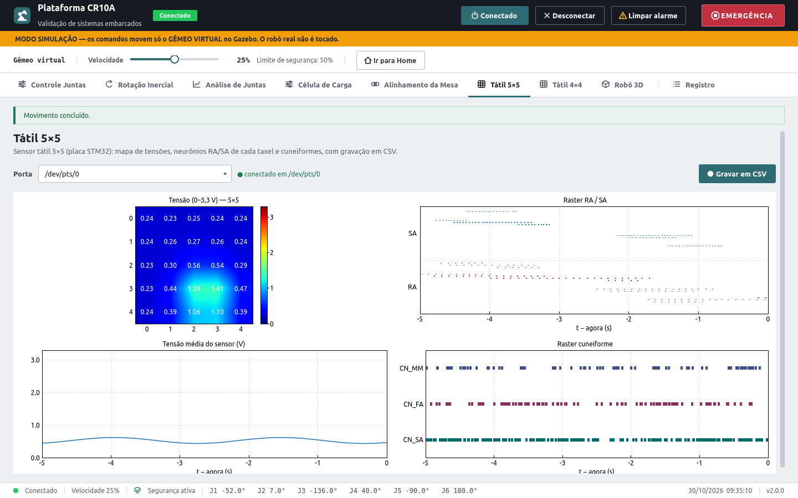

# Módulos: Tátil 5×5 e Tátil 4×4

[← Voltar para a plataforma CR10A](../../README.md)

> [!NOTE]
> **Em andamento.** A leitura e os gráficos funcionam (testados com a placa 5×5 e com uma placa
> simulada). Ainda falta: ampliar a gravação (as pastas `5x5 - resposta`, `5x5 - iris`,
> `4x4 - resposta` e `4x4 - iris` já existem em `~/dobot_registros/sensores táteis …/`) e
> fazer a placa 4×4 aparecer pela USB nativa (USB USER) da STM32.

Leitura dos **sensores táteis** de 5×5 e 4×4 taxels, cada um ligado a uma placa STM32 pela USB.
Cada sensor tem a sua aba (**Tátil 5×5** e **Tátil 4×4**). Elas mostram:
- o mapa de tensões de cada taxel;
- os disparos dos neurônios RA (rápidos) e SA (lentos) de cada taxel, calculados na placa;
- o sinal escalar;
- o neurônio pós (firmware antigo do 4×4) ou os três cuneiformes (firmware atual).

A leitura da placa é a do projeto cr10twin, sem mudanças. Os gráficos são os mesmos da figura dele, desenhados direto com o Qt: o mapa de calor ~60 vezes por segundo e os outros ~30, sem travar.

  

<em>Aba Tátil 5×5 com uma placa de teste (dados simulados): um toque que passeia
pelo sensor, os disparos RA/SA dos taxels por onde ele passou e os cuneiformes.</em>

---

## Como usar

As abas não precisam de opção no `iris` nem de botão: **ligue a placa no computador e a
aba conecta sozinha**.

1. Ligue a placa STM32 do sensor na USB, pelo conector da USB **da STM32** (USB USER). A porta
   do ST-Link sozinha não manda os dados.
2. Abra a aba do sensor. Em até alguns segundos, aparece **"● conectado em /dev/ttyACM…"**, e
   o mapa de calor começa a mexer.
3. **Gravar em CSV** grava enquanto estiver ligado (abaixo).

**Como a aba sabe qual placa é a dela:** as duas placas aparecem iguais na USB, porque são a
mesma STM32. Então, em "Automática", a aba abre cada porta livre por ~2 s e confere o tamanho
do frame: 25 taxels é o 5×5, 16 é o 4×4. Se a porta for da placa do outro sensor, ela larga e
tenta outra, e a outra aba faz o mesmo. Com as duas placas ligadas, cada aba fica com a sua. A
porta do ST-Link fica fora da busca.

**Firmware:** a aba também reconhece sozinha o que a placa está mandando. Passando o mouse
sobre o "● conectado", aparece qual é, junto com a porta, os frames bons e cortados e quantas
linhas de cada tipo chegam por segundo:

| Firmware | O que a placa manda | Quarto gráfico |
|---|---|---|
| **atual** | frames `ADC` inteiros, `RA`, `SA` e os cuneiformes `CN_SA`, `CN_RA`, `CN_MM` (o 5×5 e, desde 24/09/2026, o 4×4 do cr10twin) | Raster Cuneiforme |
| **antigo** | `DATA` por taxel, `RA`, `SA`, `TOTAL` (a corrente I_final) e `POST` | Neurônio Pós |

**Cabo solto:** a aba percebe, encerra a gravação, se houver uma, e volta a procurar. Quando a
placa volta, ela reconecta sozinha.

A **Porta** ainda pode ser escolhida à mão, para casos especiais, por exemplo um firmware que
mande os dados pela porta do ST-Link. "Automática" é o padrão.

## O que os gráficos mostram

| Gráfico | O que é |
|---|---|
| **Tensão (0–3,3 V)** | Cada quadrado é um taxel. Cor e número mostram a tensão (ADC × 3,3 / 4095). Na tela, o mapa é redesenhado ~60 vezes por segundo e mostra sempre o último frame que chegou, sem média: a cor acompanha o dedo com ~12 ms de atraso. |
| **Raster RA / SA** | Cada ponto é um disparo nos últimos 5 s. RA embaixo, SA em cima, um taxel por linha. |
| **Tensão média do sensor** / **I_final** | Os últimos 5 s. No firmware atual, é a média das tensões de cada frame. No antigo, é a corrente do neurônio pós que a placa manda na linha `TOTAL`. |
| **Raster Cuneiforme** / **Neurônio Pós** | Os disparos dos neurônios que juntam todos os taxels. |

> [!NOTE]
> No **5×5**, o mapa de calor e o raster seguem a orientação do plotter original, **girada
> 180°** em relação à numeração física que vai para o CSV. É uma escolha do cr10twin
> (`_VIEW_ROT180` em `touch_source.py`), mantida igual. No 4×4, tela e CSV têm a mesma
> numeração.

## O que é gravado

**Gravar em CSV** cria dois arquivos em `~/dobot_registros/sensores táteis 5x5/` (ou
`sensores táteis 4x4/`, uma pasta para cada sensor), com o mesmo início de nome:

- `tatilNxN_AAAAMMDD_HHMMSS_frames.csv`: uma linha por frame, com `t_stm_s` (relógio da
  placa, em segundos) e a tensão de cada taxel em volts (`v00`, `v01`, ...). A numeração é a
  **física** (`v00` = taxel físico 00), a mesma dos CSVs do cr10twin. O firmware atual manda
  cerca de 1000 frames por segundo.
- `tatilNxN_AAAAMMDD_HHMMSS_eventos.csv`: uma linha por evento, com `t_stm_s`, `tipo`
  (`RA`, `SA`, `CN_SA`, `CN_RA`, `CN_MM`, `POST` ou `TOTAL`), `taxel` (físico, nos RA/SA) e
  `valor` (o ADC no RA/SA; o I_final no `TOTAL` e no `POST`).

Frames cortados no caminho (bytes perdidos na USB) não são gravados. Passando o mouse sobre o
"● conectado", aparece quantos foram. O relógio da placa volta a zero a cada ~71 minutos.

## Se não funcionar

| A aba diz | O que fazer |
|---|---|
| "procurando a placa" e nenhuma porta em "Portas vistas" | O computador não vê a placa: confira o cabo da USB da STM32 (não só o do ST-Link) com `ls /dev/ttyACM*`. Cabo que só carrega também causa isso. |
| "nada do sensor chegou" numa porta | Essa porta abre, mas não manda os dados: o firmware não está rodando, ou é outro aparelho. |
| "placa de N taxels (outro sensor)" | Normal com as duas placas ligadas: essa é da outra aba. |

O usuário precisa estar no grupo `dialout` do Linux para abrir a porta.

---

## Onde está no código

| O quê | Onde |
|---|---|
| Abas | [`src/dobot_gui/dobot_gui/modulos/sensor_tatil.py`](../../src/dobot_gui/dobot_gui/modulos/sensor_tatil.py) |
| Leitura da placa (do cr10twin, sem mudanças) | [`src/dobot_tatil/dobot_tatil/touch_source.py`](../../src/dobot_tatil/dobot_tatil/touch_source.py) — créditos em [`NOTICE.txt`](../../src/dobot_tatil/NOTICE.txt) |
| Leitura em processo separado (para não disputar o processador com o desenho) e gravação dos CSVs | [`src/dobot_gui/dobot_gui/leitor_tatil.py`](../../src/dobot_gui/dobot_gui/leitor_tatil.py) |
| Gráficos (Qt) | [`src/dobot_gui/dobot_gui/painel_tatil.py`](../../src/dobot_gui/dobot_gui/painel_tatil.py) |
| Numeração física dos taxels | [`src/dobot_tatil/dobot_tatil/constantes_tatil.py`](../../src/dobot_tatil/dobot_tatil/constantes_tatil.py) |
