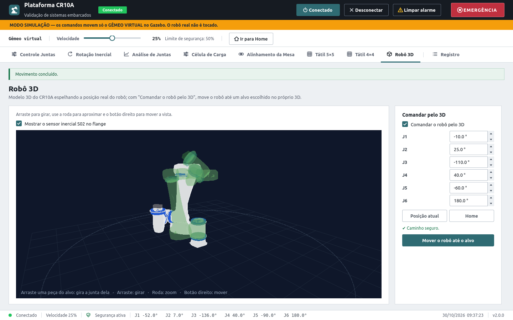

# Robô 3D: ver e comandar o robô pelo modelo 3D

[← Voltar para a plataforma CR10A](../README.md)

A página **Robô 3D** mostra o modelo do CR10A **espelhando a posição do robô** (no modo
simulação, a do gêmeo virtual). Com **Comandar o robô pelo 3D** ligado, ela também serve
para **mover o robô**: você posiciona um **robô-alvo** translúcido no próprio 3D e manda o
robô até ele.

Na ponta aparece a ferramenta com que a plataforma foi aberta: a **célula de carga com a
ponteira** (`iris`, o padrão; as mesmas peças do gêmeo do Gazebo), o **sensor
inercial S02** (`iris com-sensor`) ou **nada** (`iris sem-nada`).

  

<em>Gêmeo virtual: o robô (branco) no home e o alvo (verde) em J1 −10°, J2 25°,
J3 −110°, J5 −60°. O caminho foi conferido (✔ caminho seguro) e o botão de mover está liberado.</em>

## Movimento liso

O 3D acompanha o tópico `/dobot/estado_juntas` (cerca de 30 leituras por segundo) e desenha
a cerca de **60 quadros por segundo**, **interpolando** entre as leituras: o desenho fica
60 ms atrás do robô, o suficiente para sempre ter uma leitura antes e outra depois do instante
desenhado. Enquanto o robô anda, é usado um **modelo mais leve** (menos triângulos); quando
ele para por 0,3 s, o desenho volta ao modelo detalhado e para de redesenhar. Se o tópico
ficar mudo por mais de 1 s, o 3D passa a seguir a leitura da janela (a cada 0,4 s).

## Como usar

1. Na página **Robô 3D**, ligue **Comandar o robô pelo 3D**. Aparece o **alvo**, começando na
   posição em que o robô está.
2. Mude o alvo de um destes jeitos (**nada disso move o robô**):
   - **no 3D:** clique numa peça e **arraste para os lados**. A junta que move aquela peça
     gira (0,5° por pixel; com **Shift**, 0,1° por pixel, para o ajuste fino). A junta e o
     ângulo aparecem no alto da vista enquanto você arrasta;
   - **nos campos J1 a J6**, ao lado: digite o ângulo;
   - **Posição atual** volta o alvo para onde o robô está; **Home** põe o alvo no home.
3. A cor do alvo diz se o caminho até ele é seguro:

   | Cor | Quer dizer |
   |---|---|
   | **Amarelo** | conferindo o caminho |
   | **Verde** | ✔ caminho seguro |
   | **Vermelho** | ✖ caminho recusado; o motivo aparece embaixo dos campos (por exemplo, *"o Link5 ficaria a 8 mm da mesa"*) |

4. Com o alvo verde, clique em **Mover o robô até o alvo**, confira a janela de confirmação
   (de onde, para onde e a velocidade) e confirme.

As peças do alvo que estão no mesmo lugar que as do robô não são desenhadas (os dois
desenhos se misturariam), mas continuam clicáveis: clicar numa delas e arrastar já começa a
mexer o alvo.

## Segurança

O comando pelo 3D foi feito em camadas, para o robô só se mexer quando tudo estiver certo:

1. **Mexer no alvo nunca move o robô.** Arrastar no 3D ou digitar os ângulos só muda o
   desenho. Nenhum comando é enviado enquanto você arrasta.
2. **Verificação a cada mudança.** Um instante depois da última mudança (0,35 s), o caminho
   do robô até o alvo passa pela **mesma verificação de segurança de todo movimento** (o
   serviço `verificar_caminho` do servidor): mesa, chão, paredes, armários e o próprio braço,
   em passos de no máximo 10 mm (ver [Segurança](../README.md#segurança) e
   [Cinemática](cinematica.md)).
3. **O botão de mover só liga quando:**
   - o comando pelo 3D está ligado;
   - o alvo foi verificado e é **seguro**;
   - a verificação foi feita **a partir da posição em que o robô está agora**. Se o robô
     andar mais de 0,5° depois disso (por outra página, pelo Home…), a verificação é refeita;
   - o robô está **pronto**: conectado, sem outra ação em andamento e sem emergência;
   - a velocidade está **em até 30%**. Pelo 3D o alvo é escolhido no olho, então o limite é
     mais baixo que o geral de 50%;
   - o alvo é diferente da posição atual.

   Quando o botão está desligado, o motivo aparece logo abaixo dele.
4. **Confirmação.** Antes de mover, a janela mostra de onde, para onde e a velocidade. Se
   alguma junta for girar mais de 90°, ela avisa que o movimento é grande.
5. **O servidor confere de novo** antes de mandar o `MovJ`, como em todo movimento. Durante o
   movimento, **Parar** e **EMERGÊNCIA** continuam valendo. Ao chegar, o alvo é conferido de
   novo a partir da posição nova.

> [!TIP]
> Teste primeiro no **gêmeo virtual** (`iris gemeo`): a página funciona igual, e os
> movimentos vão só para o gêmeo.

## Onde está no código

| O quê | Onde |
|---|---|
| Página, painel de comando e regras do botão | [`src/dobot_gui/dobot_gui/modulos/robo_3d.py`](../src/dobot_gui/dobot_gui/modulos/robo_3d.py) |
| Desenho 3D, robô-alvo e escolha da peça pelo clique | [`src/dobot_gui/dobot_gui/robot_view.py`](../src/dobot_gui/dobot_gui/robot_view.py) |
| Câmera, projeção e sombreamento (do cr10twin) | [`src/dobot_gui/dobot_gui/robot3d_render.py`](../src/dobot_gui/dobot_gui/robot3d_render.py) |

| Constante (em `robo_3d.py` e `robot_view.py`) | Valor | O que é |
|---|---|---|
| `VELOCIDADE_MAX_3D` | 30% | Velocidade máxima aceita para mover pelo 3D |
| `ESPERA_VERIFICAR_MS` | 350 ms | Espera depois da última mudança do alvo antes de conferir |
| `TOLERANCIA_POSICAO_GRAUS` | 0,5° | Quanto o robô pode ter andado sem a verificação perder a validade |
| `MOVIMENTO_GRANDE_GRAUS` | 90° | Acima disso (numa junta), a confirmação avisa |
| `GRAUS_POR_PX` / `GRAUS_POR_PX_FINO` | 0,5° / 0,1° | Quanto a junta gira por pixel arrastado (normal / com Shift) |
| `QUADRO_MS` | 16 ms | Intervalo entre quadros enquanto o robô anda (~60 por segundo) |
| `ATRASO_S` | 60 ms | Quanto o desenho fica atrás das leituras, para interpolar entre duas |
| `PARADO_S` | 0,3 s | Parado por isso, o desenho volta ao modelo detalhado |
| `TRIANGLE_BUDGET_LEVE` | 2500 | Triângulos do modelo leve, usado durante o movimento |
| `FLUXO_MUDO_S` | 1 s | Sem o tópico de estado por isso, o 3D segue a leitura da janela |
